<picture>
  <source media="(prefers-color-scheme: dark)" srcset="./assets/header-dark.svg">
  <source media="(prefers-color-scheme: light)" srcset="./assets/header-light.svg">
  
</picture>

  
  
  
  

## 👋 Sobre mim

- 💼 Desenvolvedor Full Stack na **Somos Inovação em Tecnologia**
- 🧩 No dia a dia, construo sistemas web de ponta a ponta: APIs em **Java + Spring Boot** e interfaces em **Next.js + React**
- 🎓 Graduando em **Ciência da Computação**
- 📍 Paulista, Pernambuco

## 🛠️ Stack

<table>
  <tr>
    <td align="center" width="140"><b>Back-end</b></td>
    <td></td>
  </tr>
  <tr>
    <td align="center"><b>Front-end</b></td>
    <td></td>
  </tr>
  <tr>
    <td align="center"><b>Ferramentas</b></td>
    <td></td>
  </tr>
</table>

## 🚀 Projeto em destaque

<table>
  <tr>
    <td>
      <h3>🌿 <a href="https://github.com/dawydgomes/manguezal-recife">Manguezal Recife</a></h3>
      Site educativo sobre os manguezais do Recife: mapa interativo das áreas de mangue,
      minigames (corrida do caranguejo, jogo da memória e quiz), curiosidades e notícias via API do IBGE.
        
      
      
      
      
    </td>
  </tr>
</table>

## 📊 Atividade

  <picture>
    <source media="(prefers-color-scheme: dark)" srcset="https://streak-stats.demolab.com?user=dawydgomes&locale=pt_BR&hide_border=true&theme=github-dark-blue&background=0d1117&ring=2dd4bf&fire=60a5fa&currStreakLabel=2dd4bf">
    <source media="(prefers-color-scheme: light)" srcset="https://streak-stats.demolab.com?user=dawydgomes&locale=pt_BR&hide_border=true&background=ffffff&ring=0d9488&fire=2563eb&currStreakLabel=0d9488">
    
  </picture>

<picture>
  <source media="(prefers-color-scheme: dark)" srcset="https://raw.githubusercontent.com/dawydgomes/dawydgomes/output/github-snake-dark.svg">
  <source media="(prefers-color-scheme: light)" srcset="https://raw.githubusercontent.com/dawydgomes/dawydgomes/output/github-snake.svg">
  
</picture>

## 📫 Contato

  
  

